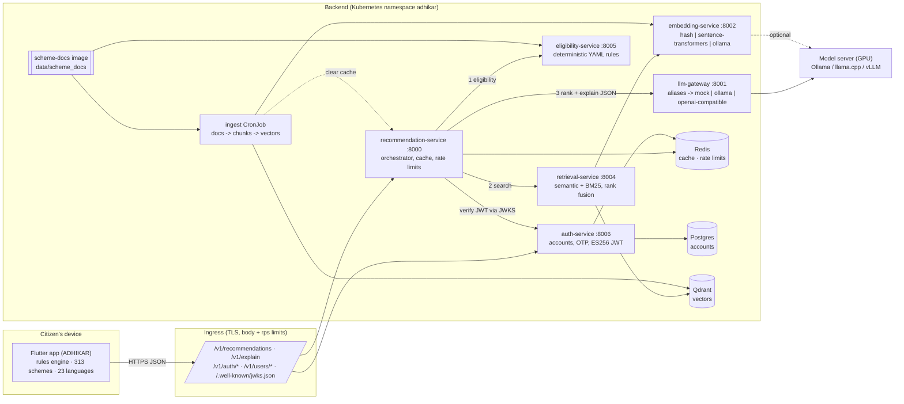
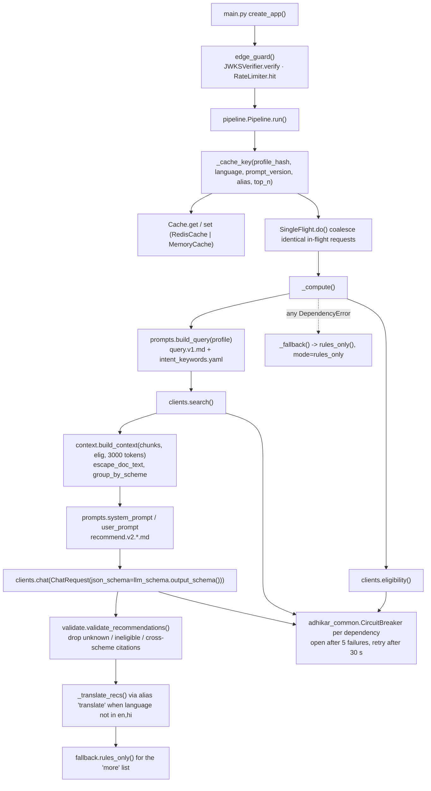

# ADHIKAR
### AI-Driven Hub for Indian Knowledge of Assistance & Rights

**ADHIKAR** (अधिकार, "rights, entitlement") stands for **AI-Driven Hub for Indian Knowledge of Assistance & Rights**.
It is a welfare-navigation platform for Indian citizens: the app asks a few questions and tells the citizen which
government welfare schemes and internships they are entitled to, in 23 Indian languages, with an explanation and
official sources for each one.

It has two halves that work independently:

| Half | Where | What it does |
|---|---|---|
| **App** (Flutter) | `lib/`, `android/`, `ios/`, `web/` ... | Works fully offline: a deterministic rule engine over a corpus of **313 schemes**, plus internships, a document checklist, text-to-speech and demo accounts. |
| **Backend** (Python, 7 microservices) | `backend/`, `deploy/k8s/` | Optional. Real accounts, and **AI-ranked recommendations with citations** (retrieval-augmented generation over scheme documents) served by a small local language model. Scales horizontally on Kubernetes. |

The app never *needs* the backend. When a backend URL is compiled in, results are shown instantly from the
on-device rules and then upgraded in place to the AI-ranked version with reasons and sources.

---

## Contents

1. [Repository layout](#1-repository-layout)
2. [Installation](#2-installation)
3. [Running it](#3-running-it)
4. [Architecture](#4-architecture)
5. [Data flow](#5-data-flow)
6. [Services, ports and contracts](#6-services-ports-and-contracts)
7. [How the code talks to itself: functions and files](#7-how-the-code-talks-to-itself-functions-and-files)
8. [The language model](#8-the-language-model)
9. [Configuration reference](#9-configuration-reference)
10. [Tests and quality gates](#10-tests-and-quality-gates)
11. [Documentation index](#11-documentation-index)
12. [Known limitations](#12-known-limitations)
13. [Android release signing](#13-android-release-signing)

---

## 1. Repository layout

```
ADHIKAR/
├── lib/                                  Flutter app (Dart package name: adhikar)
│   ├── main.dart                         entry point: boots settings + auth, shows SplashScreen
│   ├── core/
│   │   ├── config/        rag_config.dart, auth_config.dart      build-time URLs (--dart-define)
│   │   ├── models/        citizen_profile.dart, scheme_model.dart, rag_models.dart, user_model.dart ...
│   │   ├── services/      scheme_engine.dart (rules), recommendation_repository.dart (AI + fallback),
│   │   │                  recommendation_api_client.dart, auth_service.dart, auth_api_client.dart,
│   │   │                  token_store.dart, settings_service.dart, tts_service.dart ...
│   │   ├── localization/  app_translations.dart (23 languages)
│   │   └── theme/         app_theme.dart
│   ├── data/              schemes_corpus.dart (313 schemes), internships_corpus.dart
│   ├── screens/           splash, auth/, main_navigation, home, wizard/, results/, internships/, latest/,
│   │                      profile/, settings, schemes_directory
│   └── widgets/
├── test/                                 Flutter tests (engine, auth, RAG client, docs export)
├── tool/                                 export_scheme_docs.dart (corpus -> backend docs), dump_engine_parity.dart
├── assets/, android/, ios/, web/, windows/, linux/, macos/   platform projects
│
├── backend/
│   ├── services/                         7 FastAPI services, each with pyproject, tests, README, .env.example
│   │   ├── recommendation-service/  :8000  public RAG API (orchestrator)
│   │   ├── llm-gateway/             :8001  the only service that knows which LLM is used (models.yaml)
│   │   ├── embedding-service/       :8002  the only service that knows which embedding model is used
│   │   ├── ingestion-service/       :8003  documents folder -> chunks -> vectors
│   │   ├── retrieval-service/       :8004  filtered hybrid search over Qdrant
│   │   ├── eligibility-service/     :8005  deterministic rules (YAML), parity-tested with the Dart engine
│   │   └── auth-service/            :8006  accounts, OTP, ES256 JWT (Postgres)
│   ├── libs/adhikar_common/              infrastructure only: logging, request ids, metrics, breakers, cache, JWT verify
│   ├── contracts/                        OpenAPI 3.1 + JSON Schema, generated from one Pydantic file (source of truth)
│   ├── data/scheme_docs/                 the knowledge base: <scheme_id>.md + <scheme_id>.hi.md per scheme
│   ├── eval/                             golden-set evaluation harness (46 profiles) + recorded baselines
│   ├── scripts/                          dev_native.ps1 (run natively), soak_test.py, build_images.sh, gen_dev_secrets.py
│   ├── docker/                           one hardened Dockerfile for every service + the scheme-docs data image
│   ├── docker-compose.yml                full stack with mock models (CI, e2e)
│   ├── docker-compose.native.yml         infra only on 127.0.0.1 (for the native stack with a real LLM)
│   ├── docker-compose.llm.yml            containerised stack on a real Ollama server
│   ├── tests_static/, tests_e2e/         policy checks (privacy, exposure, pinning), end-to-end suite
│   ├── Makefile, constraints.txt         targets + pinned dependency versions
│   ├── SETUP_LOCAL_LLM.md                step-by-step: run a real local model on this PC (plan P13)
│   ├── ARCHITECTURE.md, CONTEXT.md       RAG pipeline design, global rules every service follows
│   └── finetune/                         (created by plan P16/P17) dataset + QLoRA fine-tuning
├── deploy/k8s/                           Kustomize base + dev/prod overlays + monitoring component
├── docs/                                 architecture, deployment, scaling, security, runbook, ADRs
├── .github/workflows/                    ci.yml (every PR), release.yml (tags)
├── plan.txt                              the build plan as executable prompts (P01..P17) + status
├── CHANGELOG.md, CONTRIBUTING.md
└── pubspec.yaml, analysis_options.yaml   Flutter project files
```

---

## 2. Installation

### 2.1 What you need

| Tool | Needed for | Install (Windows) | Install (Linux / macOS) |
|---|---|---|---|
| **Git** | everything | `winget install Git.Git` | package manager |
| **Flutter** (stable, Dart SDK 3.13+) | the app | https://docs.flutter.dev/get-started/install | same |
| **Python 3.11** | backend | `winget install Python.Python.3.11` | `apt`/`brew` or `uv python install 3.11` |
| **uv** (Python package manager) | backend venv | `winget install astral-sh.uv` | `curl -LsSf https://astral.sh/uv/install.sh \| sh` |
| **GNU make** | backend targets | `winget install ezwinports.make` (run from Git Bash) | preinstalled / `apt install make` |
| **Docker Desktop** (or Docker Engine + compose v2) | Qdrant, Redis, Postgres, containerised stack | https://docs.docker.com/desktop/ | same |
| **Ollama** | a real local LLM (optional) | `winget install Ollama.Ollama` | https://ollama.com/download |
| **NVIDIA driver** | GPU inference (optional) | current Studio driver | current driver |
| **kubectl** + a cluster | Kubernetes deploy (optional) | ships with Docker Desktop | https://kubernetes.io/docs/tasks/tools/ |

After `winget` installs, open a **new** terminal so `PATH` is refreshed.

### 2.2 Clone

```sh
git clone https://github.com/Perzival07/ADHIKAR.git
cd ADHIKAR
```

### 2.3 App install

```sh
flutter pub get
flutter doctor          # fix anything red for the platforms you target
```

### 2.4 Backend install

Linux / macOS / Git Bash on Windows:

```sh
cd backend
make install            # uv venv .venv (Python 3.11) + every service in editable mode, pinned by constraints.txt
make test               # ~900 unit, contract, eval and policy tests (mock models, no downloads)
```

PowerShell on Windows (what `make install` does, step by step):

```powershell
cd backend
uv venv .venv --python 3.11
$py = ".venv\Scripts\python.exe"
uv pip install --python $py -c constraints.txt -e libs/adhikar_common
foreach ($s in 'auth-service','llm-gateway','embedding-service','ingestion-service','retrieval-service','eligibility-service','recommendation-service') {
  uv pip install --python $py -c constraints.txt -e "services/$s[dev]"
}
uv pip install --python $py -c constraints.txt httpx pytest pytest-asyncio ruff pip-audit fakeredis aiosqlite openapi-spec-validator
```

The Makefile detects Windows and uses `.venv/Scripts` instead of `.venv/bin`, so `make test`, `make lint`,
`make eval` and `make soak` work from Git Bash once the venv exists. On Windows set `PYTHONUTF8=1` before `make test`
(a few tests read UTF-8 fixtures with the default cp1252 encoding).

### 2.5 Real local model (optional, for AI recommendations)

Follow [backend/SETUP_LOCAL_LLM.md](backend/SETUP_LOCAL_LLM.md). In short: install Ollama, pull a 3B instruct
model, download the `bge-m3` embedding model, then start the stack natively with `backend/scripts/dev_native.ps1 up`.
Nothing is needed for the mock stack.

---

## 3. Running it

### 3.1 App only (offline, rule-based)

```sh
flutter run -d chrome            # or -d windows / an Android device / an emulator
```

Demo logins: `citizen@adhikar.gov.in` or `9876543210`, password `password123`.

### 3.2 Backend with mock models (no GPU, no downloads)

```sh
cd backend
make up          # docker compose: 7 services + Postgres + Redis + Qdrant, mock LLM + hash embedder
make ingest      # load backend/data/scheme_docs into Qdrant
curl -s localhost:8000/ready
cd ..
flutter run -d chrome --dart-define=RAG_API_URL=http://localhost:8000 --dart-define=AUTH_API_URL=http://localhost:8006
```

With `AUTH_API_URL` the app uses real accounts; sign-up codes are printed in the auth-service log in development
(`docker compose logs auth-service | grep OTP`). Without it the offline demo accounts are used.
Android emulator: use `http://10.0.2.2:<port>` instead of `localhost`.

### 3.3 Backend with a real local LLM (this PC)

```powershell
cd backend
scripts/dev_native.ps1 up        # Qdrant/Redis/Postgres in Docker on 127.0.0.1 + 7 services from .venv
scripts/dev_native.ps1 ingest    # re-embed the documents with bge-m3 (new collection)
scripts/dev_native.ps1 status
make eval EVAL_TAG=qwen25-3b     # golden-set quality report -> eval/results/
make soak SOAK_TAG=qwen25-3b     # 30-minute stability test with GPU logging
scripts/dev_native.ps1 down
```

`-Mock` runs the same native stack on the mock models; `-Models <file>` picks another `models*.yaml`.
Details, GPU rules and troubleshooting: [backend/SETUP_LOCAL_LLM.md](backend/SETUP_LOCAL_LLM.md).

### 3.4 Kubernetes

```sh
cd backend && make images && make k8s-dev-secrets
kubectl apply -k ../deploy/k8s/overlays/dev
```

Production: tag a release, create the secrets, set the hosts, `kubectl apply -k deploy/k8s/overlays/prod`.
Full procedure in [docs/deployment.md](docs/deployment.md).

---

## 4. Architecture



Plain-text version of the same picture:

```
                         Internet
                            |
                 Ingress (TLS, body limit, rps limit)
              /v1/recommendations, /v1/explain | /v1/auth, /v1/users, /.well-known/jwks.json
                    |                                   |
      recommendation-service :8000            auth-service :8006 ---- Postgres (managed)
      (stateless, HPA 3..50)                  (stateless, HPA 3..20)
        |  verifies JWTs via JWKS ------------------^      \
        |  cache + rate limits --------------------------- Redis (shared by all replicas)
        |-- eligibility-service :8005   deterministic rules (docs from the scheme-docs image)
        |-- retrieval-service   :8004 -- embedding-service :8002
        |        |                  \-- Qdrant (vectors)
        '-- llm-gateway :8001  -- local / cloud model servers (aliases in models.yaml)

  CronJob "ingest" (nightly): scheme-docs image -> chunks -> embeddings -> Qdrant, then clears the reco cache
```

### Design rules that shape everything

1. **Rules decide eligibility, the model only ranks and explains.** Every model output is validated: unknown
   scheme ids, ineligible schemes, foreign citations and duplicates are dropped. If nothing valid is left, the
   API returns rules-only results. This is why a 3B model is enough ([ADR 0002](docs/adr/0002-deterministic-eligibility.md)).
2. **Knowledge lives in the documents, not in model weights.** Amounts, deadlines and criteria always come from
   retrieved chunks. New schemes mean re-ingestion, never retraining.
3. **Model independence.** Only llm-gateway and embedding-service know vendors. Everyone else uses the aliases
   `recommender` and `translate`; swapping models is a config change in one file.
4. **No shared code between services.** They talk only over HTTP using generated contracts
   ([ADR 0001](docs/adr/0001-microservices-over-http-contracts.md)). `adhikar_common` is infrastructure only.
5. **Stateless request path.** Cache, rate limits and coalescing live in Redis, so any replica can serve any request
   ([ADR 0005](docs/adr/0005-shared-state-in-redis.md)).
6. **No shared secrets.** auth-service signs ES256 tokens; everyone else verifies with its public JWKS
   ([ADR 0004](docs/adr/0004-auth-es256-jwks.md)).
7. **Privacy by construction.** The profile schema forbids name, phone and email. Logs carry a profile hash only,
   enforced by an AST test over every log call.

---

## 5. Data flow

### 5.1 A recommendation request

```mermaid
sequenceDiagram
  autonumber
  participant U as Citizen
  participant APP as Flutter app
  participant R as recommendation-service
  participant X as Redis
  participant E as eligibility-service
  participant S as retrieval-service
  participant M as embedding-service
  participant Q as Qdrant
  participant G as llm-gateway
  participant O as Model server

  U->>APP: answers the wizard (CitizenProfile)
  APP->>APP: SchemeEngine.evaluate(profile) -> instant rule-based list
  APP->>R: POST /v1/recommendations {profile, language, top_n} (+Bearer token)
  R->>R: edge_guard: verify JWT (JWKS), rate-limit per account / IP
  R->>X: GET cache[profile_hash|language|prompt|alias]
  alt cache hit
    X-->>R: cached response
  else miss (identical concurrent requests are coalesced)
    R->>E: POST /v1/eligibility {profile}
    E-->>R: [{scheme_id, status, score, reasons, missing_fields}]
    R->>S: POST /v1/search {query, filters: scheme_ids, state, language}
    S->>M: POST /v1/embed {texts:[query], kind: query}
    M-->>S: vector + model_id
    S->>Q: query_points (filtered) + scroll (keyword leg)
    Q-->>S: candidate chunks
    S-->>R: fused, diversified chunks (<= 2 per scheme)
    R->>R: build_context within the 3k-token budget, render prompt v2
    R->>G: POST /v1/chat {model_alias: recommender, messages, json_schema}
    G->>O: /api/chat (format = schema, num_ctx 4096)
    O-->>G: JSON text
    G->>G: validate; one repair round if invalid
    G-->>R: {json, usage}
    R->>R: validate_recommendations: drop hallucinations, re-rank eligible first
    R->>G: (only for non en/hi) POST /v1/chat {alias: translate}
    R->>X: SET cache (TTL 120 s)
  end
  R-->>APP: {recommendations[], more[], mode: rag | rules_only, trace_id}
  APP->>APP: RecommendationRepository merges AI reasons into the local list
  APP-->>U: results with "AI-assisted" badge, reasons, sources, missing info
```

Failure behaviour: if retrieval or the model fails, times out, or the gateway queue is full, step 18 returns
`mode: rules_only` with a `fallback_reason` instead of an error. Only an eligibility outage is a 503. Every hop
carries `X-Request-ID`; the response returns it as `trace_id`.

### 5.2 Ingestion (knowledge base)

```mermaid
flowchart LR
  C["lib/data/schemes_corpus.dart"] -->|dart run tool/export_scheme_docs.dart| D["backend/data/scheme_docs/<br/>pm_kisan.md, pm_kisan.hi.md ..."]
  D --> L["loaders.py<br/>md · txt · pdf · docx · html + YAML front-matter"]
  L --> K["chunker.py<br/>~550 tokens, 80 overlap, stable chunk ids"]
  K --> J["injection.py<br/>flag instruction-like text"]
  J --> EM["embedding-service /v1/embed (kind: document)"]
  EM --> ST["store.py -> Qdrant<br/>collection scheme_chunks__&lt;model_id&gt;"]
  ST --> MF["manifest.py (sqlite)<br/>content hash per file -> idempotent, deletes"]
  MF -.->|changed?| CC["POST recommendation-service /v1/admin/cache/clear"]
```



The collection name includes the embedding model id, so changing the embedder creates a fresh index instead of
mixing vectors. Re-run ingestion after switching models.

### 5.3 Accounts

```mermaid
sequenceDiagram
  participant APP as Flutter AuthService
  participant A as auth-service
  participant P as Postgres
  participant R as recommendation-service

  APP->>A: POST /v1/auth/otp/request {email, purpose}
  A->>A: 6-digit code, stored as HMAC, emailed (console backend in dev)
  APP->>A: POST /v1/auth/signup {email, code, password, name, state}
  A->>P: insert user (argon2id password)
  A-->>APP: {access_token (ES256, 15 min), refresh_token (30 d, rotating)}
  APP->>APP: refresh token -> Keychain / Keystore (SecureTokenStore), access token in memory
  APP->>R: POST /v1/recommendations  Authorization: Bearer <access>
  R->>A: GET /.well-known/jwks.json (cached, refetched on unknown kid)
  R->>R: verify signature, issuer, audience -> per-account rate limit
  APP->>A: POST /v1/auth/token/refresh (rotation; replay revokes the family)
```

### 5.4 Scheme detail ("explain")

`POST /v1/explain {profile, scheme_id, language}` runs eligibility for that one scheme, retrieves up to 8 chunks of
it, and asks the model for a deeper explanation, the documents required and how to apply, validated and cited the
same way. The app's detail screen uses it when the backend is configured.

---

## 6. Services, ports and contracts

| Service | Port | Env prefix | State | Public endpoints | Calls |
|---|---|---|---|---|---|
| recommendation-service | 8000 | `RECO_` | Redis (cache, limits) | `POST /v1/recommendations`, `POST /v1/recommendations/stream` (SSE), `POST /v1/explain`, `POST /v1/admin/cache/clear` | eligibility, retrieval, llm-gateway, auth (JWKS) |
| llm-gateway | 8001 | `LLMGW_` | none | `POST /v1/chat` (JSON or SSE), `GET /v1/models` | model servers listed in `models.yaml` |
| embedding-service | 8002 | `EMBED_` | none | `POST /v1/embed` | local model / Ollama |
| ingestion-service | 8003 | `INGEST_` | sqlite manifest (PVC) | `POST /v1/ingest`, `GET /v1/ingest/status`, `DELETE /v1/docs/{scheme_id}` | embedding, Qdrant, reco (cache clear) |
| retrieval-service | 8004 | `RETRIEVAL_` | none | `POST /v1/search` | embedding, Qdrant, (optional) llm-gateway reranker |
| eligibility-service | 8005 | `ELIG_` | read-only docs | `POST /v1/eligibility`, `POST /v1/admin/reload` | nothing |
| auth-service | 8006 | `AUTH_` | Postgres, Redis | `/v1/auth/otp/request`, `/signup`, `/login`, `/login/otp`, `/token/refresh`, `/logout`, `/logout-all`, `/v1/users/me` (GET/PATCH/DELETE), `/.well-known/jwks.json` | Postgres, SMTP |

Every service also exposes `GET /health` (process up), `GET /ready` (dependencies reachable) and `GET /metrics`
(Prometheus). Only recommendation-service and auth-service are reachable from outside.

**Contracts.** All request/response types are defined once in
[backend/contracts/contract_models.py](backend/contracts/contract_models.py). `generate.py` derives
`openapi/*.yaml` and `schemas/*.json`; `sync.py` copies an identical `contract_models.py` into each service so no
service imports another. CI fails if either is stale ([contracts README](backend/contracts/README.md)).
The Flutter client mirrors the recommendation contract in `lib/core/models/rag_models.dart`.

---

## 7. How the code talks to itself: functions and files

### 7.1 Flutter app

```mermaid
flowchart TD
  MAIN["main.dart<br/>main() -> SettingsService.init(), AuthService.init()"] --> SPL["SplashScreen"]
  SPL -->|auth.isAuthenticated| NAV["MainNavigationScreen"]
  SPL -->|else| SIGN["SignInScreen / SignUpScreen / OtpVerificationScreen"]
  SIGN --> AS["AuthService (ChangeNotifier)"]
  AS -->|AUTH_API_URL set| AAC["AuthApiClient -> auth-service /v1/auth/*"]
  AS -->|offline| SP["SharedPreferences demo accounts (salted sha256)"]
  AS --> TS["TokenStore: SecureTokenStore (Keychain/Keystore) | MemoryTokenStore"]
  NAV --> HOME["HomeScreen"] & DIR["SchemesDirectoryScreen"] & INT["InternshipsScreen"] & LAT["LatestUpdatesScreen"] & PROF["ProfileScreen"] & SET["SettingsScreen"]
  HOME --> WIZ["AdaptiveWizardScreen<br/>builds a CitizenProfile"]
  WIZ -->|SchemeEngine.evaluate(profile)| RES["SchemesResultScreen"]
  RES -->|_loadAi()| REPO["RecommendationRepository.recommend()"]
  REPO -->|RAG_API_URL set & AI enabled| RAC["RecommendationApiClient.recommend()<br/>POST /v1/recommendations"]
  REPO -->|always| ENG["SchemeEngine.evaluate() (fallback + merge)"]
  RAC --> RM["rag_models.dart: RagResponse / RagRecommendation / RagCitation"]
  RES --> DET["SchemeDetailScreen<br/>document checklist, portal link, TTS"]
  SET --> SS["SettingsService: language, state, AI toggle, document checks"]
  DET --> TTS["TtsService (flutter_tts)"]
```

Key functions and what they call:

| File | Function | Calls / is called by |
|---|---|---|
| `lib/main.dart` | `main()` | `SettingsService.init()`, `AuthService.init()`, `LatestUpdatesService.fetchUpdates()`, then `runApp(AdhikarApp)` which rebuilds on either service's `notifyListeners()` |
| `lib/screens/splash_screen.dart` | `_navigateToNextScreen()` | reads `auth.isAuthenticated` → `MainNavigationScreen` or `SignInScreen` |
| `lib/screens/wizard/adaptive_wizard_screen.dart` | finish step | fills a `CitizenProfile`, runs `SchemeEngine.evaluate`, pushes `SchemesResultScreen(profile, eligibleSchemes)` |
| `lib/core/services/scheme_engine.dart` | `SchemeEngine.evaluate(profile)` | one `switch (scheme.id)` case per scheme → score (≥ 0.5 = eligible) + bilingual reason; same logic as the backend's YAML rules (parity-tested on 431 profiles) |
| `lib/screens/results/schemes_result_screen.dart` | `_loadAi()`, `_onSettingsChanged()` | `RecommendationRepository.recommend(profile, language, aiEnabled)`; re-requests on language / AI-toggle change; discards stale answers by request id |
| `lib/core/services/recommendation_repository.dart` | `recommend()` | `RecommendationApiClient.recommend()`; drops unknown ids; merges `AiExtras` (reason, citations, missing info); appends any rules-found scheme the AI omitted; `local()` on any failure with a `fallbackReason` |
| `lib/core/services/recommendation_api_client.dart` | `recommend()` | `POST {RAG_API_URL}/v1/recommendations` with `CitizenProfile.toJson()` (no name/phone/email), `X-Request-ID`, optional Bearer token from `AuthService.accessToken` |
| `lib/core/services/auth_service.dart` | `signIn`, `signUp`, `completeOtp`, `refresh`, `signOut`, `deleteAccount` | remote: `AuthApiClient` + `TokenStore`; local: SharedPreferences accounts, `EmailOtpService` |
| `lib/core/services/settings_service.dart` | `setLanguage`, `setSelectedState`, `setAiRecommendationsEnabled`, `toggleDocumentCheck` | `aiRecommendationsEnabled = RagConfig.isConfigured && preference` |
| `lib/core/config/rag_config.dart`, `auth_config.dart` | `RagConfig.apiUrl`, `AuthConfig.apiUrl` | `String.fromEnvironment` → `--dart-define=RAG_API_URL=...`, `AUTH_API_URL=...` |
| `tool/export_scheme_docs.dart` | `main()` | `SchemesCorpus.getSchemes()` → deterministic `backend/data/scheme_docs/<id>.md` + `<id>.hi.md` with front-matter matching `SchemeDocMeta` |
| `tool/dump_engine_parity.dart` | `main()` | runs the Dart engine on profiles → fixture consumed by `eligibility-service/tests/test_parity.py` |

### 7.2 Backend: request path inside recommendation-service



| File | Role |
|---|---|
| `main.py` | FastAPI app factory; `edge_guard` (auth mode off/optional/required, rate limits); `/v1/recommendations`, `/stream`, `/explain`, `/admin/cache/clear`; `/ready` probes the three dependencies |
| `pipeline.py` | `Pipeline.run()` / `.explain()`: the orchestration above; stage timings and counters via `metrics.py` |
| `clients.py` | `Clients.eligibility()`, `.search()`, `.chat()`, `.chat_stream()`: typed HTTP calls with timeouts, `X-Request-ID` propagation and one circuit breaker per service |
| `context.py` | packs retrieved chunks into `<doc id=".." scheme="..">` blocks within the token budget, eligible schemes first |
| `prompts.py` + `prompts/*.md` | versioned prompt files rendered with `str.format`; query builder; language names |
| `llm_schema.py` | the JSON schema the model must follow (`recommendations[]`, `explain`, `translations`) |
| `validate.py` | the real safety layer: only ids present in context and eligible, citations owned by that scheme, quotes that exist in the chunk, eligible ranked before unknown |
| `fallback.py` | rules-only ranking by eligibility score + retrieval order with templated reasons |
| `limits.py`, `ratelimit.py`, `singleflight.py` | body-size limit, per-IP / per-account limits, request coalescing |

### 7.3 Backend: the other services

| Service | Entry → core functions | What they do |
|---|---|---|
| **llm-gateway** | `main.py` → `Gateway.chat()` → `Limiter` (concurrency 1, bounded queue, else 429) → `Registry.get(alias)` + fallback chain → `provider.chat()` → `jsonmode.validate()` → one repair round | Providers in `providers/`: `mock.py`, `ollama.py` (`/api/chat` with `format` = JSON schema), `openai_compat.py` (`/v1/chat/completions`, llama.cpp / LM Studio / vLLM). `registry.py` reads `models.yaml`. `stream()` serves SSE. |
| **embedding-service** | `main.py` → `providers.build_provider()` → `embed()` / `info()` | `hash_provider.py` (deterministic, dev), `st_provider.py` (local sentence-transformers folder, CPU by default, never downloads), `ollama_provider.py`. Returns `model_id` + `dim` so indexes never mix. Inputs over the cap are truncated and flagged. |
| **ingestion-service** | `__main__.py ingest` / `POST /v1/ingest` → `Ingestor.run()` → `documents.iter_documents` / `load_document` → `chunker.chunk_section` → `injection.looks_like_instructions` → `EmbeddingClient.embed` → `Store.upsert` → `Manifest.put` → `clear_downstream_cache` | One run at a time; per-file error isolation; path-traversal guard; `watcher.py` for watch mode. |
| **retrieval-service** | `main.py` → `Searcher.search()` → `_embed_query` → `build_filter` (status verified, scheme ids, state/All/central, language + en) → Qdrant `query_points` + `_scan` → `fusion.bm25_rank` + `fusion.rrf` → `prefer_language` → optional `Reranker` → `diversify` | Hybrid semantic + keyword search with reciprocal rank fusion, per-scheme cap, language fallback. |
| **eligibility-service** | `main.py` → `Rules.load()` (`rules/central.yaml`, `state.yaml`, `generic.yaml` validated by `rules.schema.json`) → `Engine.evaluate()` → `dsl.evaluate` conditions over `profile_ctx.build_context(profile)` → `dsl.render` reasons | Deterministic; `schemes.py` reads scheme metadata from the docs front-matter; parity fixture proves identical output to the Dart engine. |
| **auth-service** | `main.py` routes → `service.py` (business rules) → `security.py` (argon2id, OTP HMAC, ES256 JWT, refresh rotation) → `db.py` (SQLAlchemy async) → `migrations/` (Alembic, advisory lock) → `email.py` (console / SMTP) → `seed.py` (dev users) | `config.py` refuses unsafe production settings. `python -m auth_service migrate | gen-key`. |

### 7.4 Shared library and cross-cutting files

| File / package | Used by | Provides |
|---|---|---|
| `backend/libs/adhikar_common` | every service | `setup_json_logging`, `RequestIDMiddleware` + `outbound_headers()` (propagates `X-Request-ID`), `AccessLogMiddleware`, Prometheus `Registry` / `install_metrics`, `CircuitBreaker`, `Cache` / `RateLimiter` (Redis or memory, fail open), `JWKSVerifier`, `profile_hash` / `redact_profile` |
| `backend/contracts/contract_models.py` | generated into every `services/*/src/*/contract_models.py` | `CitizenProfile` (extra = forbid), `EligibilityResult`, `Chunk`, `SchemeDocMeta`, `Recommendation`, `ChatRequest` ... |
| `backend/services/llm-gateway/models.yaml` (mirrored in `deploy/k8s/base/models.yaml`) | llm-gateway | alias → provider/model/options; a test keeps the two copies identical |
| `backend/services/llm-gateway/models.ollama.yaml` | native stack / `docker-compose.llm.yml` | the same aliases pointed at a local Ollama model |
| `backend/data/scheme_docs/` | eligibility (metadata), ingestion (text), eval (known ids) | one English + one Hindi markdown file per scheme with YAML front-matter |
| `backend/eval/` | CI gate, model comparisons | `python -m eval run --target URL --tag NAME`, `python -m eval compare a.json b.json`; metrics: recall@5/10, violation rate, unknown-id rate, citation coverage, JSON-valid rate, fallback rate, latency |
| `deploy/k8s/base/*.yaml` | cluster | one Deployment + Service + PDB (+ HPA, NetworkPolicy) per service, `adhikar-config` ConfigMap, `llm-models` ConfigMap, ingest CronJob |

---

## 8. The language model

The stack runs on a **mock** LLM and a **hash** embedder until you configure real models; every test and CI job
works that way. A real model is a configuration change in llm-gateway and embedding-service only.

| Piece | Default (mock stack) | Real local setup (plan P13, this PC) |
|---|---|---|
| Recommender / translator | `provider: mock` | Ollama, `qwen2.5:3b-instruct-q4_K_M` (candidate 2: `llama3.2:3b-instruct-q4_K_M`), `num_ctx` 4096, concurrency 1 |
| Embeddings | `hash` (384-d, deterministic) | `BAAI/bge-m3` through sentence-transformers on the **CPU** (multilingual; Hindi documents) |
| Where it runs | containers | Ollama on `127.0.0.1:11434` on the RTX 3070 Ti; Python services natively (`scripts/dev_native.ps1`) |
| Routing file | `services/llm-gateway/models.yaml` | `services/llm-gateway/models.ollama.yaml` |

Why a 3B model works here: the model never decides eligibility and never has to know scheme facts. It ranks a
short, pre-filtered candidate list, writes two sentences per scheme and cites the chunk ids it was given, under a
JSON schema that Ollama enforces at decode time. The output is validated again by the service.

Prompts are files in `backend/services/recommendation-service/src/recommendation_service/prompts/`
([README](backend/services/recommendation-service/src/recommendation_service/prompts/README.md)); v2 is the compact
small-model prompt in use.

Model switch, soak test, evaluation, GPU/driver rules and troubleshooting are in
[backend/SETUP_LOCAL_LLM.md](backend/SETUP_LOCAL_LLM.md). The follow-up steps in [plan.txt](plan.txt) are
**P16** (build a fine-tuning dataset that teaches the *task*, never facts) and **P17** (QLoRA fine-tune, export to
Ollama as `adhikar-reco-3b`, evaluate against the baseline, ship only if hallucination and JSON validity improve
without hurting recall).

Adding a cloud model (a hosted model) means implementing `llm_gateway.providers.base.LLMProvider`, registering it
in `providers/__init__.py`, and referencing it in `models.yaml`. Nothing else changes.

---

## 9. Configuration reference

**App (compile-time, `--dart-define`)**

| Define | Effect |
|---|---|
| `RAG_API_URL` | enables AI recommendations (`RecommendationApiClient`); empty = offline rules only |
| `AUTH_API_URL` | enables server accounts (`AuthApiClient`); empty = offline demo accounts |

**Backend (environment, one prefix per service; defaults in each `config.py`, examples in each `.env.example`)**

| Variable | Default | Meaning |
|---|---|---|
| `LLMGW_MODELS_FILE` | `models.yaml` | alias routing file |
| `LLMGW_OLLAMA_BASE_URL` | `http://host.docker.internal:11434` | Ollama address when an alias omits `base_url` |
| `LLMGW_CONCURRENCY` / `LLMGW_QUEUE_MAX` | 1 / 8 | one generation at a time per GPU; waiting slots before 429 |
| `LLMGW_READ_TIMEOUT` | 120 | seconds to wait for the model |
| `EMBED_PROVIDER` | `hash` | `hash` \| `sentence_transformers` \| `ollama` |
| `EMBED_MODEL_PATH`, `EMBED_DEVICE` | "", `cpu` | local model folder for sentence-transformers |
| `EMBED_OLLAMA_MODEL`, `EMBED_OLLAMA_BASE_URL` | "", Ollama URL | Ollama embedder |
| `RECO_PROMPT_VERSION` | `v2` | prompt files to use |
| `RECO_CONTEXT_TOKEN_BUDGET` | 3000 | retrieved text budget for the prompt |
| `RECO_DIRECT_LANGUAGES` / `RECO_PIVOT_LANGUAGE` | `en,hi` / `en` | languages the model writes directly; others are translated |
| `RECO_LLM_TIMEOUT`, `RECO_REQUEST_DEADLINE` | 90, 120 | seconds |
| `RECO_AUTH_MODE` | `optional` | `off` \| `optional` \| `required` |
| `RECO_REDIS_URL` | "" | shared cache + limits (empty = in-memory, single replica) |
| `RECO_RATE_LIMIT_PER_MINUTE` / `_USER` | 60 / 120 | per IP / per account |
| `RECO_ADMIN_TOKEN` | "" | enables `POST /v1/admin/cache/clear` |
| `INGEST_DOCS_DIR`, `INGEST_CACHE_CLEAR_URL` | docs folder, "" | source folder; cache invalidation after a changed run |
| `RETRIEVAL_RERANKER` | `none` | `llm` enables a reranking pass through llm-gateway |
| `AUTH_DATABASE_URL`, `AUTH_JWT_PRIVATE_KEY`, `AUTH_OTP_SECRET`, `AUTH_SMTP_*` | | required in production; dev generates an ephemeral key and prints OTPs |

Kubernetes puts the non-secret values in the `adhikar-config` ConfigMap and the routing file in the `llm-models`
ConfigMap ([docs/deployment.md](docs/deployment.md)).

---

## 10. Tests and quality gates

| Command | What runs |
|---|---|
| `flutter analyze && flutter test` | app lints and widget/engine/client tests |
| `make -C backend lint test` | ruff + ~900 tests: per-service unit tests, contract tests, eligibility parity (431 profiles), eval harness tests, static policies (no profile fields in logs, only public ports published, hardened Dockerfile, pinned deps, k8s manifests hardened, markdown links resolve) |
| `make -C backend e2e` | docker compose stack with mocks, ingest, 5 golden profiles end to end, request-id trace across services |
| `make -C backend eval` | golden-set quality report (46 profiles) against a running stack |
| `make -C backend soak SOAK_TAG=x` | 30-minute sequential load with GPU logging (real model) |
| `make -C backend audit` | pip-audit over the pinned dependencies |

CI ([.github/workflows/ci.yml](.github/workflows/ci.yml)) runs all of the above except soak on every pull request,
with a real Postgres for the migration test, Kubernetes manifest validation, and a quality gate on the golden set
(recall@10 ≥ 0.95, zero violations, zero errors). Releases add Trivy image scans, SBOMs and signed provenance.

---

## 11. Documentation index

| Doc | What's in it |
|---|---|
| [backend/SETUP_LOCAL_LLM.md](backend/SETUP_LOCAL_LLM.md) | Run a real local model on this PC: GPU roles, Ollama settings, candidates, embeddings, wiring, soak test, eval, troubleshooting |
| [backend/ARCHITECTURE.md](backend/ARCHITECTURE.md) | The RAG pipeline services in depth, reliability and observability |
| [backend/CONTEXT.md](backend/CONTEXT.md) | The global rules every service follows (small-model design, privacy, local-first) |
| [docs/architecture.md](docs/architecture.md) | System view: ingress, auth, scaling, request lifecycle, [ADRs](docs/adr/) |
| [docs/deployment.md](docs/deployment.md) | Kubernetes prerequisites, secrets, first deploy, upgrades, rollback |
| [docs/scaling.md](docs/scaling.md) | What scales how, LLM capacity model, scale-out triggers |
| [docs/security.md](docs/security.md) | Accounts and tokens, platform hardening, data handling |
| [docs/runbook.md](docs/runbook.md) | Alerts and what to do about them |
| [backend/contracts/README.md](backend/contracts/README.md) | How contracts are generated, versioned and synced |
| [CONTRIBUTING.md](CONTRIBUTING.md) | Development workflow and the rules of the codebase |
| [CHANGELOG.md](CHANGELOG.md) | What changed when |
| [plan.txt](plan.txt) | The build plan (P01..P17) with status; P13, P16, P17 are the model steps |

---

## 12. Known limitations

- **Quality numbers on the mock stack say nothing about a real model.** Use `make eval` against the native stack
  with a real model; the first baselines are recorded under `backend/eval/results/` as they are produced.
- **Corpus vs. rules:** about 10 scheme ids in the Dart rules (for example `pm_suraksha_bima`, `mgnrega`) are not in
  the 313-scheme corpus, so those rules never fire.
- **SMS OTP is not implemented**; codes go by email. Phone-number accounts sign in with a password.
- **The LLM is the throughput bottleneck**: one uncached recommendation = one model call (3 to 10 s on a consumer
  GPU). Caching, coalescing, rate limits and the rules-only fallback keep the API responsive; throughput grows with
  model servers ([docs/scaling.md](docs/scaling.md)).
- **Containers cannot reach a model server bound to `127.0.0.1`.** On a developer PC run the services natively
  (`scripts/dev_native.ps1`) or expose Ollama on an interface Docker can reach, firewalled to your machine.
- **Display and inference on one GPU** compete for VRAM. Plug the monitors into the second GPU before soak tests
  (see the setup guide).

---

## 13. Android release signing

Create `android/key.properties` (git-ignored) with `storeFile`, `storePassword`, `keyAlias`, `keyPassword`, then
`flutter build apk --release`. Without that file the build is signed with the debug key and must not be published.
